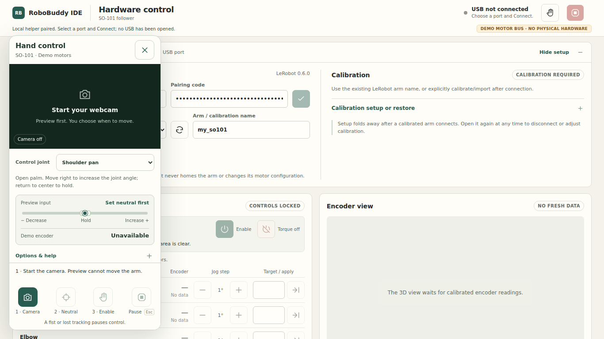
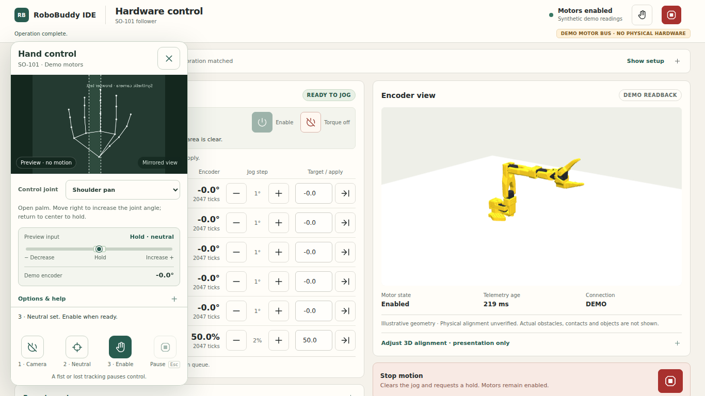
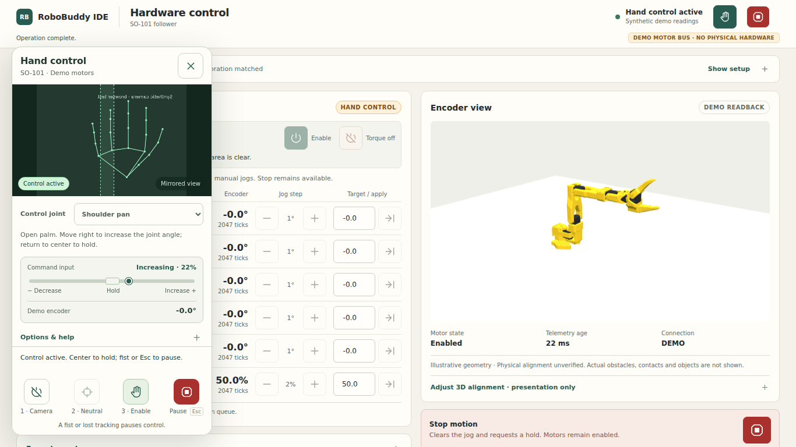
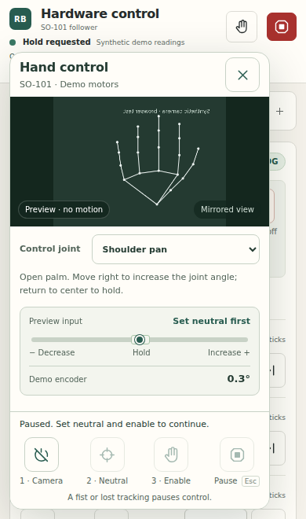
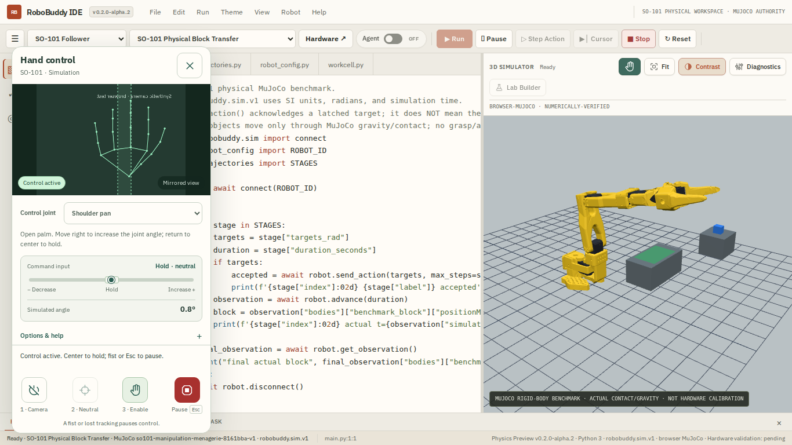
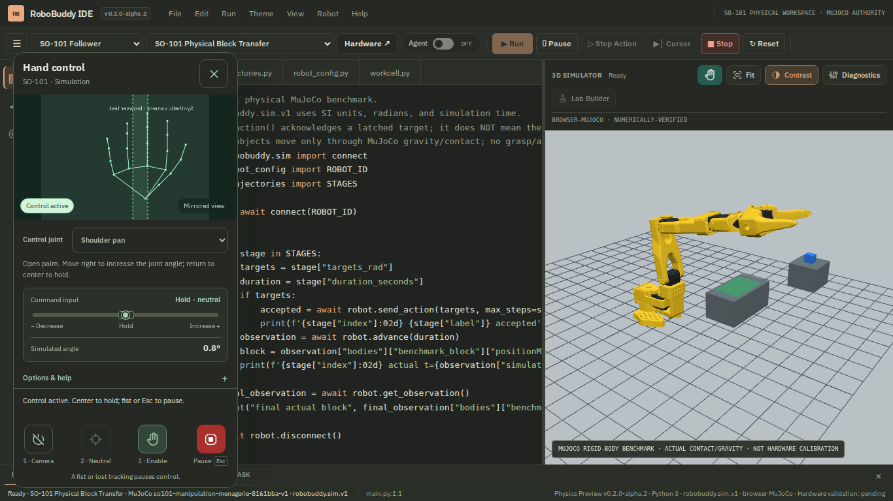

# SO-101 gesture control: fidelity and UX review

Reviewed October 20, 2026 against feature commit `3d38acb`, the attached physics implementation plan dated September 7, and the current repository guardrails. This review covers the new webcam input path and its integration with the existing SO-101 simulator and local hardware helper. It does not certify the robot model, assembled hardware or camera recognition quality.

## Findings and corrections

| Priority | Finding in the original feature | Refinement and evidence |
| --- | --- | --- |
| High | Simulator takeover could advance an unselected joint's previous program target. | Capture measured actuator hold goals before advancing the existing PhysicsSession. The real MuJoCo browser test leaves an unfinished elbow target, then confirms shoulder control does not resume that elbow movement. |
| High | A slow motor read could consume the remaining gesture/operator lease between the expiry check and a moving write. | Recheck expiry after sampling and check the operator lease immediately before writes. A deterministic slow-bus test confirms an expired moving goal is replaced with a hold. This remains a software response, not a measured emergency stop. |
| High | Camera startup and control cancellation shared an epoch; changing a joint during loading could leave a live camera with an unusable panel. Concurrent pause/close callers did not share cleanup completion. | Independent camera lifecycle; one awaited control cleanup; neutral revalidation after asynchronous enable. Tests cover slow loading, cancellation, concurrent pause/close, moved neutral and released tracks. |
| Medium | Distances and angles treated independently normalized image x/y coordinates as equal units. The fixed overlay did not account for wide or portrait cameras. | Correct image-space geometry using actual bitmap dimensions; letterbox-aware overlay. Geometry tests preserve the same pixel-space hand across aspect ratios; a wide-camera browser test verifies alignment dimensions. |
| Medium | Smoothing could retain the old motion sign briefly after a direction reversal. | Reset previous input on sign reversal; retain immediate zero in the neutral band. Regression checks both behaviors. |
| Medium | Centering could reuse old encoder samples or leave a small residual servo goal when a target had already settled. Unselected holds could drift with repeated rebasing. | Capture fresh selected-joint readback once on centering; retain unselected hold goals. The simulator likewise latches its neutral actuator target instead of following subsequent physical deflection. Tests verify current sampling, no repeated hold rebasing and unchanged unselected goals. |
| Medium | The operator had no readable direction/input indicator or selected-joint readback inside the panel; all actions looked equally important. | Guided setup, preview/active badges, neutral band, input meter, accurately labelled readback, clear prerequisite messages and a prominent Pause action. |
| Medium | Small screens could scroll the control actions out of view. The IDE theme could add a stray square beside the hand icon; Graphite did not style the panel. | Fixed action footer and title; scroll only preview/settings; correct icon styling and shared typography; theme-aware panel colors. Desktop, phone and short landscape layouts inspected. |

## Flow review

1. **Open and start camera — verified in software.** The empty state explains preview, requests the camera only after an explicit click and indicates loading. Denied permission is recoverable. Hardware readiness is explained separately from camera readiness.
2. **Choose a joint and capture neutral — verified in software.** All six joints remain available. A stable valid hand is required; changing the joint/direction resets capture. Enable stays unavailable when prerequisites or a current neutral are missing. Keyboard focus moves to Enable after a successful capture.
3. **Control — verified in software.** Active state is visible in the panel and launcher. Direction, input strength and the selected joint's readback are distinct. Simulation uses one existing MuJoCo authority and actuator targets; the hardware demo uses the existing helper and independent gesture lease. Simulation Run and Agent Assist remain excluded during takeover and cleanup.
4. **Pause, recover and close — verified in software.** Fist, Esc, either Pause control, stale/ambiguous tracking and loss of focus disarm input. There is no automatic re-enable. Pause and Close stay reachable on narrow/short screens. Close, tab hiding and camera failure release camera tracks. Reset/workspace switching wait for cleanup.

## Evidence

Fresh baseline captures were inspected for opening, neutral, active control and paused phone states. Fresh refined captures were inspected at 1366 × 768 (hardware and simulator), 390 × 660, and in Paper and Graphite. The shared cloud browser could not reach the local server, so captures came from the repository's local Chromium test environment. They contain synthetic camera imagery and demo motor data, not an observed user's webcam or physical arm.

The browser checks produce `test-results/so101-gesture-ready-desktop.png`, `so101-gesture-active-desktop.png`, `so101-gesture-active-mobile.png`, `so101-simulator-hand-control.png` and `so101-simulator-hand-control-dark.png`. CI uploads `test-results/` as evidence. Selected accepted captures are preserved below as review evidence. All camera imagery and motor readings in these captures are synthetic.

Validation completed:

- Released LeRobot 0.6.0 driver import/signature check, without USB.
- 56 controller, transport and driver tests, including 14 gesture cases.
- 8 local hardware-panel browser tests, including gripper/reverse direction, camera startup/cancel, wide frames, stale frames, explicit motor enable and responsive layouts.
- 2 asynchronous lifecycle tests, extended integration with the real MuJoCo worker, and real MediaPipe model/WASM inference on a blank image.
- Gesture geometry and immediate reversal, actuator takeover/latched hold/authority isolation, hardware client priority/order, joint mapping, static fidelity and WebMCP core regressions.

## Accepted captures

### 1. Camera — explicit preview

### 2. Neutral — readiness and input preview

### 3. Control — live input and selected-joint readback

### 4. Pause — persistent controls on a small screen

### Simulator and Graphite theme

## Limits and interpretation

No joint/body pose is assigned to simulate motion; measured-position holds are controller goals. Rendering still consumes authoritative physics observations and does not advance the simulation clock. Normalized camera input is relative joint jogging, not Cartesian pose/depth estimation, inverse kinematics, measured velocity or collision detection.

The image geometry correction follows MediaPipe's documented independently normalized x/y coordinates: [official Hand Landmarker web guide](https://ai.google.dev/edge/mediapipe/solutions/vision/hand_landmarker/web_js). The pinned tracker and model versions were retained.

Keyboard focus, labels, live status, readable active states and touch targets were checked in the implementation and browser flows. This is not a full screen-reader or WCAG conformance audit. Hand recognition across real lighting, skin tones, occlusion, handedness and camera devices requires live trials. Calibration, physical motor direction, collision clearance and stopping response still require supervised SO-101 commissioning. The existing draft PR remains unmerged; the live deployment is unchanged.
